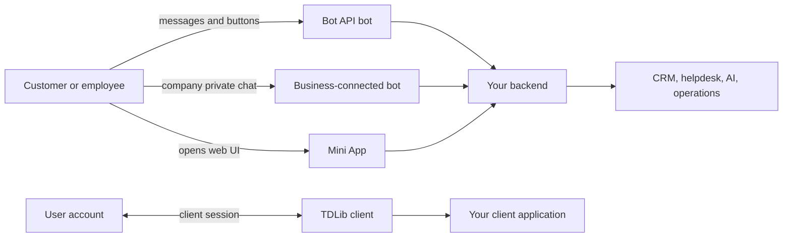

# Step 1 — Choose the Telegram surface

## Learning goal

After this lesson, you should be able to explain who is acting in Telegram, what data the integration can receive, and why Bot API, Business, Mini Apps, and TDLib are different tools.

## Mental model

These surfaces have different identities and permissions. A bot is a separate Telegram participant. A Business bot acts through a company's selected Business connection and its granted rights. A Mini App is a web frontend launched through Telegram; it still needs a backend for trusted identity and business authorization. TDLib is a client library for an authorized user account, with account-level session material to protect.

## Read and inspect

1. Read the [capability map](../02-research/capability-map.md), especially its access and identity columns.
2. Compare the [Java/Spring README](../examples/java-spring/README.md) with the [TDLib README](../examples/tdlib-java/README.md).
3. Read [J01](../tasks/completed-issues/J01.md) for the shared test boundary and [J12](../tasks/completed-issues/J12.md) for a deliberately narrow TDLib example.

## Apply it

For a release notification, a Bot API sender is usually enough. For selected customer one-to-one chats answered through a company Business account, assess Business bot rights and handoff rules. For a structured booking form, launch a Mini App and validate the signed launch data on your server. Choose TDLib only when your product must operate as a user-account client.

## Checkpoint

For your use case, write down: **who sends**, **who receives**, **which chat types**, **which data is necessary**, and **which system makes authorization decisions**. If those answers are unclear, do not pick a library yet.

**Issue trail:** J01, J12, J13. **Evidence status:** architectural choice guide; no live Telegram account or provider connection is implied.
