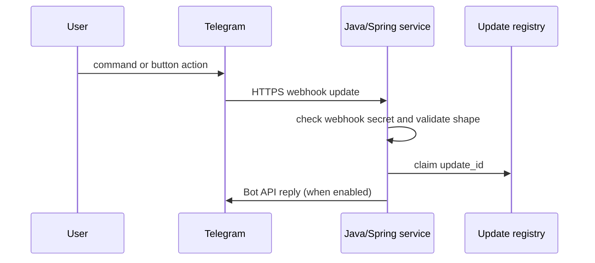

# Step 2 — Build the bot service boundary

## Learning goal

Understand the two directions of a bot integration: your service sends Bot API requests, and Telegram delivers updates to your service. Learn why secret handling and idempotency belong at this boundary.

## Mental model

Outgoing HTTP is not the same as receiving updates. A webhook must be reachable over HTTPS and authenticated with Telegram's configured webhook secret. Since updates can be retried, store an idempotency key before repeating external side effects. The sample registry is in memory, so it teaches the seam but is not multi-instance production storage.

## Read and inspect

1. Run the credential-free [Java/Spring sample](../examples/java-spring/README.md) and read its configuration section.
2. Follow [`TelegramBotClient`](../examples/java-spring/src/main/java/example/telegram/TelegramBotClient.java) and [`TelegramWebhookController`](../examples/java-spring/src/main/java/example/telegram/TelegramWebhookController.java).
3. Read [`TelegramUpdateRegistry`](../examples/java-spring/src/main/java/example/telegram/TelegramUpdateRegistry.java) and the [webhook tests](../examples/java-spring/src/test/java/example/telegram/TelegramWebhookControllerTest.java).
4. Use the J01–J03 guides: [foundation](../tasks/completed-issues/J01.md), [sender](../tasks/completed-issues/J02.md), [webhook](../tasks/completed-issues/J03.md).

## Apply it

For a Spring Boot service, keep request construction behind a small client, validate webhook authentication before parsing actions, and use a durable shared idempotency store before scaling horizontally. Put secrets in a secret manager. Leave sends disabled in local development and test outbound requests with fake HTTP.

## Checkpoint

Explain what happens if Telegram delivers the same `update_id` twice, and what changes when the app is deployed as two replicas. The in-memory sample cannot coordinate those replicas; production needs shared state.

**Issue trail:** J01–J03. **Verification:** local mock/unit tests only; no webhook was registered and no message was sent.
