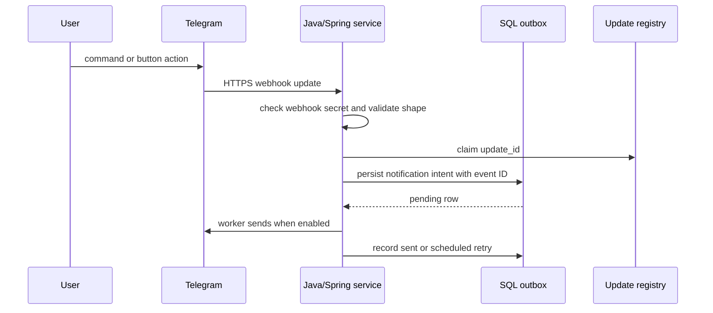

# Step 2 — Build the bot service boundary

## Learning goal

Understand the two directions of a bot integration: your service sends Bot API requests, and Telegram delivers updates to your service. Learn why secret handling and idempotency belong at this boundary.

## Mental model

Outgoing HTTP is not the same as receiving updates. A webhook must be reachable over HTTPS and authenticated with Telegram's configured webhook secret. Since updates can be retried, store an idempotency key before repeating external side effects. The update registry remains in memory. J16 adds a separate SQL outbox for outbound notices; do not confuse one with the other.

An outbox persists the intent to notify and lets a worker retry after process restarts. The sample uses H2 and bounded states: pending → sending (lease) → sent, retry, failed, or expired. The attempt number fences a stale worker after another worker reclaims its expired lease. Telegram documents `retry_after` for flood control, which the sender uses as a minimum wait. An outbox cannot atomically commit a Telegram send and a SQL update; a lost response can still lead to a duplicate message.

## Read and inspect

1. Run the credential-free [Java/Spring sample](../examples/java-spring/README.md) and read its configuration section.
2. Follow [`TelegramBotClient`](../examples/java-spring/src/main/java/example/telegram/TelegramBotClient.java) and [`TelegramWebhookController`](../examples/java-spring/src/main/java/example/telegram/TelegramWebhookController.java).
3. Read [`TelegramUpdateRegistry`](../examples/java-spring/src/main/java/example/telegram/TelegramUpdateRegistry.java) and the [webhook tests](../examples/java-spring/src/test/java/example/telegram/TelegramWebhookControllerTest.java).
4. Use the J01–J03 guides: [foundation](../tasks/completed-issues/J01.md), [sender](../tasks/completed-issues/J02.md), [webhook](../tasks/completed-issues/J03.md).
5. Follow [J16](../tasks/completed-issues/J16.md) and inspect [`JdbcNotificationOutbox`](../examples/java-spring/src/main/java/example/telegram/JdbcNotificationOutbox.java), [`NotificationOutboxDispatcher`](../examples/java-spring/src/main/java/example/telegram/NotificationOutboxDispatcher.java), and [outbox tests](../examples/java-spring/src/test/java/example/telegram/JdbcNotificationOutboxTest.java).

## Apply it

For a Spring Boot service, keep request construction behind a small client, validate webhook authentication before parsing actions, and use a durable shared idempotency store before scaling horizontally. For important notices, insert the outbox row in the same database transaction as the business state change. Put secrets in a secret manager. Leave sends disabled in local development and test outbound requests with fake HTTP.

## Checkpoint

Explain how duplicate `update_id` handling differs from outbox event de-duplication. Then explain why a durable outbox still cannot guarantee exactly-once Telegram delivery after an ambiguous timeout.

**Issue trail:** J01–J03, J16. **Verification:** local H2 and mock/unit tests only; no webhook was registered and no message was sent.
