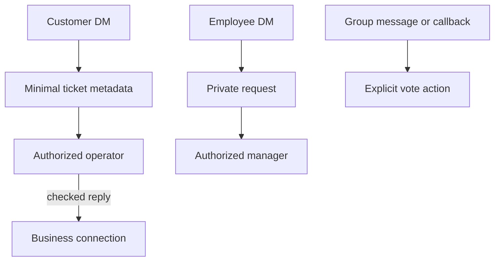

# Step 3 — Model people and chat permissions

## Learning goal

Learn to design a Telegram workflow around the people and chat boundaries involved, rather than assuming every bot sees every message or can perform every action.

## Mental model

Private bot chats, groups, Business-connected chats, and channels have different visibility and permissions. A group bot receives updates according to Bot API rules, privacy mode, membership, and granted rights; it does not automatically get the full prior history. Business integrations are scoped by the connected account's chosen chats and rights. Application roles should come from your own trusted authorization source, not from a Telegram display name or group-admin badge.

## Read and inspect

1. Read the repository's [group and topic research](../02-research/groups-and-topics.md) and [support guide](../02-research/support.md).
2. Compare [`GroupVoteService`](../examples/java-spring/src/main/java/example/telegram/GroupVoteService.java), [`BusinessSupportService`](../examples/java-spring/src/main/java/example/telegram/BusinessSupportService.java), [`InternalRequestService`](../examples/java-spring/src/main/java/example/telegram/InternalRequestService.java), and the [Chatwoot support lesson](08-chatwoot-support.md).
3. Read issue notes [J04](../tasks/completed-issues/J04.md), [J05](../tasks/completed-issues/J05.md), [J15](../tasks/completed-issues/J15.md), and [J17](../tasks/completed-issues/J17.md).

## Apply it

For a group vote, make the action explicit with a callback and validate the actor, chat, vote state, and option server-side. For customer support, create a minimal ticket and an authenticated operator workflow; allow a company-scoped reply only while the Business connection permits it. For employee approvals, use an independent role directory and require confirmation for consequential actions.

## Checkpoint

For each proposed bot feature, answer: can the bot see this update, which actor is allowed to cause this state change, and what prevents a stale or repeated button press from repeating the action?

**Issue trail:** J04/J05/J15/J17. These samples use synthetic identities and in-memory state; they do not connect a company account, employee directory, or helpdesk.
