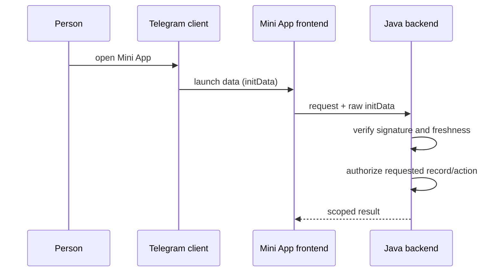

# Step 4 — Add a web interface with Mini Apps

## Learning goal

Understand when chat buttons stop being a good interface, how a Mini App launch connects Telegram to a web frontend, and why the backend must verify identity and authorization.

## Mental model

Telegram launch data can help the backend establish which Telegram user opened the app when its signature is verified. It does not prove that the user owns an arbitrary order or may approve an action. Your application must still check its own records and permissions. Group launch context does not create shared authorization or expose group history.

## Read and inspect

1. Read the [Mini Apps technical notes](../02-research/technical-notes.md) and the official [Mini Apps documentation](https://core.telegram.org/bots/webapps).
2. Inspect [`TelegramInitDataValidator`](../examples/java-spring/src/main/java/example/telegram/TelegramInitDataValidator.java), [`MiniAppController`](../examples/java-spring/src/main/java/example/telegram/MiniAppController.java), and [controller tests](../examples/java-spring/src/test/java/example/telegram/MiniAppControllerTest.java).
3. Read the [J07 completion note](../tasks/completed-issues/J07.md) and frontend/backend instructions in the [sample README](../examples/java-spring/README.md).

## Apply it

Use chat messages and buttons for short, linear actions. Use a Mini App for structured forms, multi-step orders, dashboards, or shared selections that need a richer interface. Pass raw `initData` to the backend, validate its HMAC and age there, and check access to every resource independently. Use HTTPS and persistent storage for a real deployment.

## Checkpoint

Why is `initDataUnsafe.user.id` insufficient as authorization? Your answer should mention server-side signature verification and application-level ownership checks.

**Issue trail:** J07. Tests use synthetic signed launch data. A live bot launch, public URL, or production authorization system was not configured.
