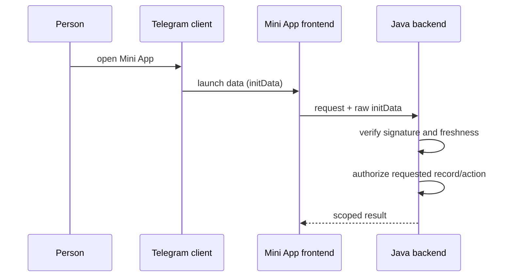

# Step 4 — Add a web interface with Mini Apps

## Learning goal

Understand when chat buttons stop being a good interface, how a Mini App launch connects Telegram to a web frontend, and why the backend must verify identity and authorization.

## Mental model

Telegram launch data can help the backend establish which Telegram user opened the app when its signature is verified. It does not prove that the user owns an arbitrary order or may approve an action. Your application must still check its own records and permissions. Group launch context does not create shared authorization or expose group history.

### Shared state in a group

Telegram direct-link Mini Apps can include signed `chat_type` and `chat_instance` launch fields. These identify the launch context; they do not prove that the user is a member of a group or may read a particular application record. J18 demonstrates a separate server-side allowlist for exact chat/user pairs and stores one availability contribution per authorized user. Other participants see aggregate slot counts, while the submitting user sees their own contribution.

Each update includes the board version the user last read. The service applies one update atomically and increments the version. A stale conflicting edit receives HTTP 409 and the latest board, so the user can inspect it and retry. Repeating an update whose contribution is already current is idempotent and does not increment the version. This in-memory synchronized example only coordinates one process; multiple instances need durable shared storage and an atomic database update.

## Read and inspect

1. Read the [Mini Apps technical notes](../02-research/technical-notes.md) and the official [Mini Apps documentation](https://core.telegram.org/bots/webapps).
2. Inspect [`TelegramInitDataValidator`](../examples/java-spring/src/main/java/example/telegram/TelegramInitDataValidator.java), [`MiniAppController`](../examples/java-spring/src/main/java/example/telegram/MiniAppController.java), [`SharedMiniAppController`](../examples/java-spring/src/main/java/example/telegram/SharedMiniAppController.java), [`SharedAvailabilityBoardService`](../examples/java-spring/src/main/java/example/telegram/SharedAvailabilityBoardService.java), and their tests.
3. Read the [J07](../tasks/completed-issues/J07.md) and [J18](../tasks/completed-issues/J18.md) completion notes and frontend/backend instructions in the [sample README](../examples/java-spring/README.md).

## Apply it

Use chat messages and buttons for short, linear actions. Use a Mini App for structured forms, multi-step orders, dashboards, or shared selections that need a richer interface. Pass raw `initData` to the backend, validate its HMAC and age there, and check access to every resource independently. For shared group features, treat `chat_instance` as context only and apply an application authorization rule. Use HTTPS and persistent storage for a real deployment.

## Checkpoint

Why is `initDataUnsafe.user.id` insufficient as authorization? Your answer should mention server-side signature verification and application-level ownership checks.

**Issue trail:** J07 and J18. Tests use synthetic signed launch data. A live bot launch, public URL, or production authorization system was not configured.
