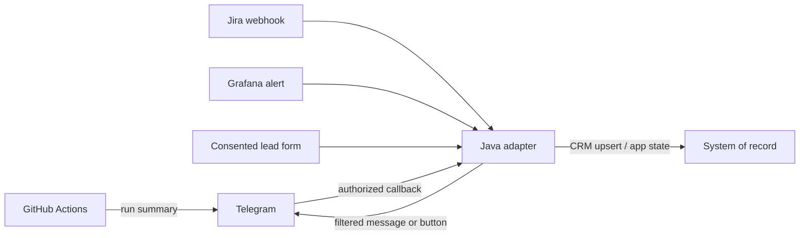

# Step 5 — Connect business and operations systems

## Learning goal

See Telegram as a notification and action surface around systems of record. Learn the common webhook-adapter pattern and distinguish an acknowledgement in your app from changing the upstream system.

## Mental model

Keep durable business state in GitHub, Jira, Grafana, or the CRM. Telegram should summarize a useful event or collect a narrowly authorized action. Validate webhook signatures against raw request bytes, filter and minimize fields, de-duplicate delivery, and include a link back to the source. A callback that records “seen” in your app is not automatically an acknowledgement or resolution in Grafana/Jira. For important notifications, persist the intent in an outbox and make failure and duplicate behavior visible to operators.

## Read and inspect

1. Read [technical integrations research](../02-research/technical-integrations.md) and [product catalog](../02-research/product-catalog.md).
2. Inspect [`JiraWebhookController`](../examples/java-spring/src/main/java/example/telegram/JiraWebhookController.java), [`GrafanaWebhookController`](../examples/java-spring/src/main/java/example/telegram/GrafanaWebhookController.java), [`SalesLeadService`](../examples/java-spring/src/main/java/example/telegram/SalesLeadService.java), and [`CiNotificationFormatter`](../examples/java-spring/src/main/java/example/telegram/CiNotificationFormatter.java).
3. Read [J06](../tasks/completed-issues/J06.md), [J08](../tasks/completed-issues/J08.md), [J09](../tasks/completed-issues/J09.md), and [J14](../tasks/completed-issues/J14.md).
4. Read [J16](../tasks/completed-issues/J16.md) to see how durable delivery differs from a best-effort direct send.

## Apply it

Start with one event and one destination: build failure → short message + workflow URL. Then add signature validation and filters for Jira/Grafana webhooks. For sales capture, ask for data directly from the customer with a clear notice and consent; write only those fields to CRM and keep marketing subscription consent separate. Use an automation platform when its connector exposes the specific trigger/action and controls you need; a connector name alone does not prove full feature support. Use an outbox when losing a notice matters, and explain that ambiguous network outcomes can still duplicate a send.

## Checkpoint

For a webhook-triggered Telegram button, name the system of record, the state that the button changes, the user authorization check, and the idempotency key. If a button changes only local state, say so explicitly.

**Issue trail:** J06/J08/J09/J14/J16. Local tests use mocks; no real GitHub delivery, Jira tenant, Grafana instance, CRM write, or Telegram message was performed.
