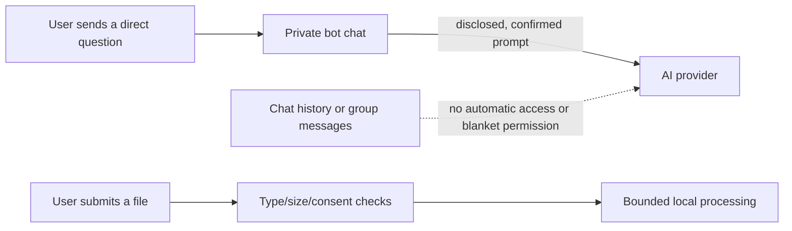

# Step 6 — Handle files and AI deliberately

## Learning goal

Separate a user asking an AI a question from an AI indexing Telegram-origin data. Learn the boundaries around consent, file handling, provider disclosure, and what the bot actually receives.

## Two different data flows

**AI as interface:** the user directly sends a prompt to the bot, understands the provider and purpose, and confirms that specific request. **Telegram data as AI source:** the application retrieves or indexes messages/files from Telegram chats. These are not equivalent. Technical access to content does not itself grant permission to process it with AI. Telegram policies impose restrictions on collecting platform data for AI/ML; review current Telegram API Terms, Content Licensing Terms, and Bot Developer Terms before any such workflow. The sample avoids historical and group ingestion entirely.

## Read and inspect

1. Read [AI and Telegram data](../02-research/ai-and-data.md) and the current [Telegram API Terms](https://core.telegram.org/api/terms), [Content Licensing Terms](https://telegram.org/tos/content-licensing), and [Bot Developer Terms](https://telegram.org/tos/bot-developers).
2. Inspect [`FileIntakeService`](../examples/java-spring/src/main/java/example/telegram/FileIntakeService.java), [`BotReplyService`](../examples/java-spring/src/main/java/example/telegram/BotReplyService.java), and [`ClaudeClient`](../examples/java-spring/src/main/java/example/telegram/ClaudeClient.java).
3. Read [J10](../tasks/completed-issues/J10.md) and [J11](../tasks/completed-issues/J11.md).

## Apply it

For file intake, disclose purpose, accept only needed formats and sizes, store temporarily with restricted access, and define cleanup. For AI, disclose the model/provider and data handling, require a clear action for each prompt, allow cancellation/revocation, and keep human handoff explicit. Do not silently append chat history, group messages, customer files, or Business content to a prompt.

## Checkpoint

Classify each proposed input as **directly submitted to the bot for this purpose** or **retrieved from Telegram as platform data**. Then identify the user's choice, provider recipient, retention, and deletion path. A checkbox or account login is not a universal permission for every use.

**Issue trail:** J10/J11. Tests use synthetic text and mock provider calls; no live AI request or Telegram file download was made. Rules checked 2026-11-15; recheck before deployment.
