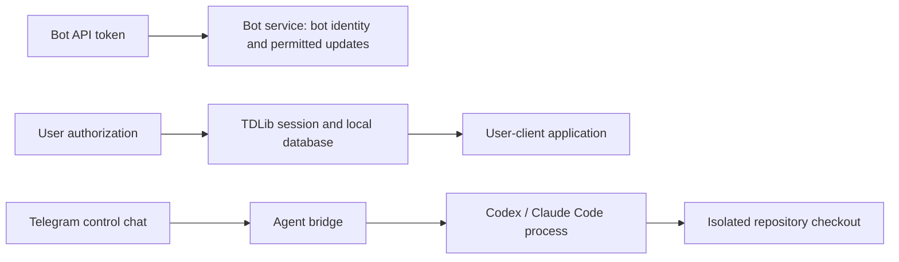

# Step 7 — Understand TDLib and coding-agent bridges

## Learning goal

Distinguish a Telegram bot integration from an application logged in as a user, and understand why remote control of a coding agent needs stronger isolation than a normal chat workflow.

## Mental model

TDLib is a client library. It does not turn a bot into a user client, and it only acts with the authorized account's access. Session files and keys are sensitive account material. A Telegram-to-agent bridge adds another trust boundary: who may issue instructions, which repository and shell tools are exposed, what runs in a sandbox, and when a human must approve changes.

## Read and inspect

1. Read the [implementation landscape](../02-research/implementation-landscape.md) for product categories and source/runtime evidence.
2. Inspect the isolated [TDLib Java README](../examples/tdlib-java/README.md) and [`AuthorizationFlow`](../examples/tdlib-java/src/main/java/example/telegram/tdlib/AuthorizationFlow.java).
3. Read the [J12 guide](../tasks/completed-issues/J12.md) and [J13 guide](../tasks/completed-issues/J13.md).

## Apply it

Choose TDLib only for a product requirement that genuinely needs a user-account client; plan native packaging, secure session storage, logout, and revocation. For phone-based coding-agent use, first evaluate the agent's own supported remote-control features. A custom bridge should begin with a dedicated account and isolated checkout, allowlisted users, read/test/patch-preparation actions, and explicit approvals before writes or shell execution.

## Checkpoint

List which credentials a bot bridge needs versus a TDLib client, where each runs, and the consequence if its token/session is stolen. Then list one boundary preventing a group member from executing an arbitrary command.

**Issue trail:** J12/J13. The TDLib sample's fake authorization tests were run as part of its implementation; JNI login and third-party agent bridge projects were not run with real accounts or repositories.
