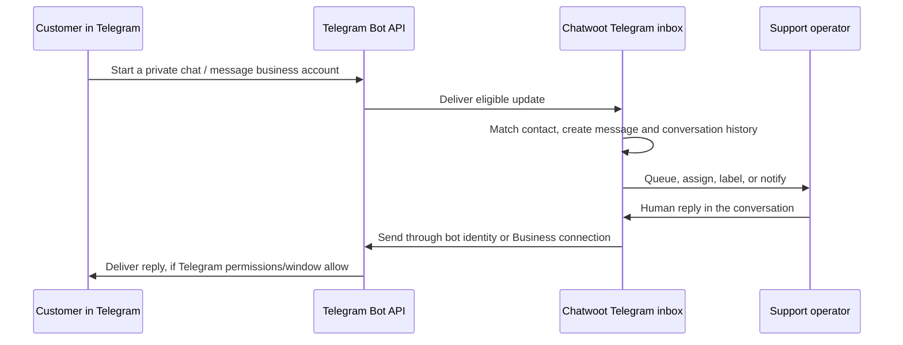

# Step 8 — Run Telegram customer support through Chatwoot

## Learning goal

Separate a helpdesk's built-in Telegram channel from custom Java integration code. Trace customer identity, operator assignment, reply authority, stored history, and the limits of a mock test.

## Two Telegram inbox choices

**Standard Bot API inbox:** create a bot with BotFather, add a Telegram inbox in Chatwoot, provide that bot's token, and add agents. A customer must contact the bot; a standard bot is its own Telegram sender identity. A Chatwoot agent is the human author inside the helpdesk, while Telegram sees the bot as the message sender; the agent's personal Telegram account is not involved. Chatwoot receives updates Telegram delivers to the bot and agents reply in the Chatwoot inbox. This does not make the bot a Telegram user account or expose the customer's general Telegram history.

**Telegram Business bot inbox:** Chatwoot documents support starting in v4.3.0. Enable Business Mode for the bot in BotFather, connect that bot to the Telegram Business account with the intended chat scope and rights, then add it to a dedicated Chatwoot Telegram inbox. Telegram Business updates carry a business connection ID. Replies must use that connection and Telegram requires the `can_reply` right; it only permits replies in private chats with incoming customer activity in the last 24 hours. Rights such as marking a message read or deleting messages are separate; do not request them unless the workflow needs them. The account owner chooses which chats and rights to grant. The Chatwoot agent remains the human author in the helpdesk; Telegram sends the reply on behalf of the connected Business account, not the agent's personal Telegram account.

The 24-hour constraint described here is specific to Telegram Business bot replies; do not apply it as a universal Bot API conversation policy.

This is a rolling customer-activity window, not a 24-hour limit measured from assignment. A handoff does not pause or extend it. If it expires, Chatwoot cannot make Telegram accept an ordinary reply; follow up manually through an allowed channel or wait for the customer to message again. Chatwoot recommends keeping the Business bot in its own inbox; if a person previously spoke to that same bot directly, replies can appear from the bot rather than the Business account.

### Simple Business inbox flow

1. The account owner connects the Business bot to the Business account and grants `can_reply` for the intended chats. The right authorizes replies; assignment alone does not grant Telegram permission.
2. At **10:00**, the customer sends a private message. Telegram delivers the Business update, including its connection ID, to Chatwoot. Treat 10:00 as the start of the rolling 24-hour reply window.
3. At **10:20**, Chatwoot matches the contact and conversation, stores the incoming message, and assigns conversation `481` to `agent-7`. Assignment routes the work; it does not start or reset the timer.
4. At **11:00**, `agent-7` replies in the Business inbox. Chatwoot sends through the Business connection; Telegram can accept it because `can_reply` is granted and the customer's latest activity was at 10:00, only one hour earlier.
5. If the customer sends another message at **15:00**, that newer incoming activity moves the rolling window's start to 15:00. Without newer customer activity, an ordinary reply after 10:00 the next day is outside the window, regardless of when an operator was assigned.

The timestamps are illustrative and synthetic. In a real inbox, use the latest incoming customer activity recorded for the conversation when reasoning about the window; operator assignment and operator replies are not customer activity.

## Data flow

The conversation belongs to Chatwoot. Its source code models message rows with content, sender, timestamps, message type, channel and conversation IDs, and message metadata; attachments are separate records/files. Chatwoot also keeps contact and conversation data, and its Telegram channel stores the bot token (the source conditionally encrypts it when encryption is configured). Plan retention, deletion, access, backups and attachment storage for your Chatwoot deployment. “Conversation history” means the messages Chatwoot has received and retained; it is not a Telegram account archive or an automatic import of old messages.

Chatwoot's built-in channel does the Telegram webhook, contact/conversation mapping, operator inbox, assignment, message persistence and Telegram send. The Java class [`ChatwootSupportHandoff`](../examples/java-spring/src/main/java/example/telegram/ChatwootSupportHandoff.java) is a **mock-friendly application-side choreography seam**. It accepts a synthetic incoming-message reference, keeps only the conversation ID, assigns that conversation, and allows the assigned operator to request a reply. It has no Telegram client, Chatwoot HTTP client, webhook endpoint, durable state, or credentials. The fake test verifies this local sequence and authorization; it does not implement Chatwoot's channel or prove a live API contract. For the ordinary human workflow, agents can work entirely in Chatwoot and this Java seam is unnecessary.

If you later connect a Java service to Chatwoot, keep API access tokens in a secret manager or environment variables, authenticate the operator in your own backend, and verify Chatwoot webhook authenticity before trusting a customer or assignment event. Do not use an integration token to make a reply look like a different agent. Use synthetic credentials only in local tests; for example, configure `CHATWOOT_BASE_URL`, `CHATWOOT_ACCOUNT_ID`, `CHATWOOT_API_ACCESS_TOKEN`, and an allowlisted agent ID through the process environment. No such values are committed here.

## Read and inspect

1. Read Chatwoot's [Telegram channel setup](https://www.chatwoot.com/hc/user-guide/articles/1677838569-how-to-setup-a-telegram-channel) and [channel/inbox overview](https://www.chatwoot.com/hc/user-guide/articles/1677492191-adding-inboxes).
2. Read Telegram's [Bot API Business connection and rights](https://core.telegram.org/bots/api#businessconnection) and [Business bot guide](https://core.telegram.org/bots/features#connected-business-bots).
3. Inspect Chatwoot's [`Channel::Telegram` source](https://github.com/chatwoot/chatwoot/blob/develop/app/models/channel/telegram.rb) for webhook setup, message send and use of `business_connection_id`, and the [`Message` model](https://github.com/chatwoot/chatwoot/blob/develop/app/models/message.rb) for stored fields and attachments.
4. Compare [`ChatwootSupportHandoff`](../examples/java-spring/src/main/java/example/telegram/ChatwootSupportHandoff.java), its [fake-backed tests](../examples/java-spring/src/test/java/example/telegram/ChatwootSupportHandoffTest.java), and [J05](../tasks/completed-issues/J05.md). J05 is a separate custom Business Bot API sample, not Chatwoot.

## CVNoor application

Chatwoot could inform a **proposed, owner-gated** CVNoor support pilot: let Chatwoot own agent operations and history while CVNoor systems remain authoritative for candidate/employer records. Before any pilot, an owner would need to approve the channel, account and data scope, retention, who can access conversations, escalation and identity-linking rules. This repository contains no CVNoor implementation or approval; J16's H2 outbox is only a local notification teaching example and does not deliver CVNoor support messages.

## Exercise and checkpoint

Use the synthetic conversation ID `481` and agents `agent-7` and `agent-9`. The focused test assigns `481` to `agent-7`, attempts a reply from `agent-9`, and checks that the fake gateway records only the assignment. Trace the Business inbox flow above and identify the granted `can_reply` right and latest customer activity time.

Before a live pilot, answer: what identifies the contact, who owns the message history, what exactly authorizes the sender identity, where is the reply window enforced, and who can view/delete stored messages and files?

**Verification boundary:** the Java example was tested with a fake gateway and synthetic IDs/text. No Chatwoot instance, Telegram bot, Business account or customer chat was configured or contacted. A live setup is needed to verify channel creation, webhook delivery, assignment and reply appearance/sender identity in Telegram, Business rights, attachment handling, retention/deletion, and the deployed version's behavior.

**Sources checked:** Chatwoot documentation and `develop` source, and Telegram Bot API documentation, on 2026-11-15. Recheck them before deployment.
