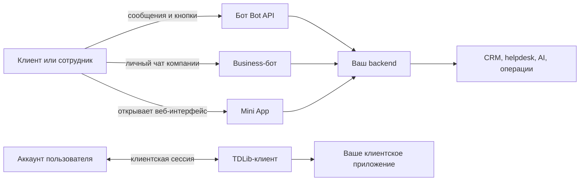

# Шаг 1 — Выбрать способ взаимодействия с Telegram

## Цель обучения

После этого урока вы сможете объяснить, кто действует в Telegram, какие данные интеграция получает и чем отличаются Bot API, Business, Mini Apps и TDLib.

## Ментальная модель

У этих способов разные identity и права. Бот — отдельный участник Telegram. Business-бот действует через выбранное подключение Business-аккаунта и выданные права. Mini App — веб-интерфейс, запущенный через Telegram; для доверенной identity и бизнес-проверок всё равно нужен backend. TDLib — клиентская библиотека для авторизованного пользовательского аккаунта; данные его сессии нужно защищать.

## Прочитать и посмотреть

1. Изучите [карту возможностей](../02-research/capability-map.md), особенно столбцы доступа и identity.
2. Сравните [README Java/Spring](../../examples/java-spring/README.md) и [README TDLib](../../examples/tdlib-java/README.md).
3. Прочитайте [J01](../../tasks/completed-issues/J01.md) о тестовой границе и [J12](../../tasks/completed-issues/J12.md) об узком примере TDLib.

## Пример применения

Для уведомления о релизе обычно достаточно отправителя Bot API. Для выбранных личных диалогов клиентов, где отвечает аккаунт компании, изучите права Business-бота и передачу оператору. Для формы записи откройте Mini App и проверьте подписанные данные запуска на сервере. TDLib выбирайте только при реальной необходимости клиентского приложения под пользовательским аккаунтом.

## Самопроверка

Для своего сценария запишите: **кто отправляет**, **кто получает**, **какие типы чатов**, **какие данные нужны** и **какая система принимает решение о доступе**. Пока ответы неясны — не выбирайте библиотеку.

**Связанные задачи:** J01, J12, J13. **Статус доказательств:** это руководство по архитектурному выбору, а не свидетельство живого подключения к Telegram.
