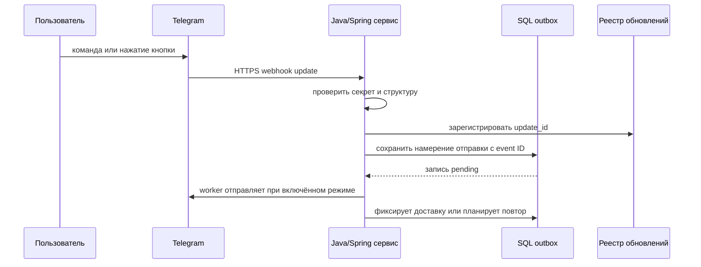

# Шаг 2 — Построить границу bot-сервиса

## Цель обучения

Разобраться в двух направлениях интеграции бота: приложение вызывает Bot API, а Telegram доставляет обновления приложению. Понять, зачем на этой границе нужны защита секрета и идемпотентность.

## Ментальная модель

Исходящий HTTP-вызов — не то же самое, что получение обновлений. Webhook должен быть доступен по HTTPS и проверять настроенный секрет Telegram. Telegram может повторить update, поэтому ключ идемпотентности нужно сохранить до повторения внешнего действия. Реестр update остаётся в памяти. В J16 добавлен отдельный SQL outbox для исходящих уведомлений — это разные механизмы.

Outbox сохраняет намерение отправить уведомление и позволяет worker повторить попытку после перезапуска. В примере используется H2 и ограниченные состояния: pending → sending (lease) → sent, retry, failed или expired. Номер попытки защищает от записи устаревшим worker после того, как другой worker забрал просроченный lease. Telegram документирует `retry_after` для flood control, и sender учитывает его как минимальное ожидание. Outbox не объединяет отправку в Telegram и SQL-обновление в одну транзакцию; потерянный ответ всё ещё может привести к дубликату.

## Прочитать и посмотреть

1. Запустите credential-free [пример Java/Spring](../../examples/java-spring/README.md) и прочитайте раздел конфигурации.
2. Проследите [`TelegramBotClient`](../../examples/java-spring/src/main/java/example/telegram/TelegramBotClient.java) и [`TelegramWebhookController`](../../examples/java-spring/src/main/java/example/telegram/TelegramWebhookController.java).
3. Откройте [`TelegramUpdateRegistry`](../../examples/java-spring/src/main/java/example/telegram/TelegramUpdateRegistry.java) и [тесты webhook](../../examples/java-spring/src/test/java/example/telegram/TelegramWebhookControllerTest.java).
4. Изучите J01–J03: [основа](../../tasks/completed-issues/J01.md), [отправитель](../../tasks/completed-issues/J02.md), [webhook](../../tasks/completed-issues/J03.md).
5. Пройдите [J16](../../tasks/completed-issues/J16.md) и изучите [`JdbcNotificationOutbox`](../../examples/java-spring/src/main/java/example/telegram/JdbcNotificationOutbox.java), [`NotificationOutboxDispatcher`](../../examples/java-spring/src/main/java/example/telegram/NotificationOutboxDispatcher.java) и [тесты outbox](../../examples/java-spring/src/test/java/example/telegram/JdbcNotificationOutboxTest.java).

## Пример применения

В Spring Boot оставьте построение запросов за небольшим клиентом, проверяйте webhook до разбора действий и используйте общую постоянную идемпотентность перед горизонтальным масштабированием. Для важных уведомлений добавляйте строку outbox в ту же транзакцию, где меняется бизнес-состояние. Храните секреты в secret manager. Оставьте отправку выключенной при локальной разработке и тестируйте запросы fake HTTP.

## Самопроверка

Объясните, чем обработка повтора `update_id` отличается от дедупликации события outbox. Затем объясните, почему постоянный outbox всё равно не гарантирует ровно одну доставку Telegram после неоднозначного timeout.

**Связанные задачи:** J01–J03, J16. **Проверка:** локальные H2 и mock/unit-тесты; webhook не регистрировался, сообщения не отправлялись.
