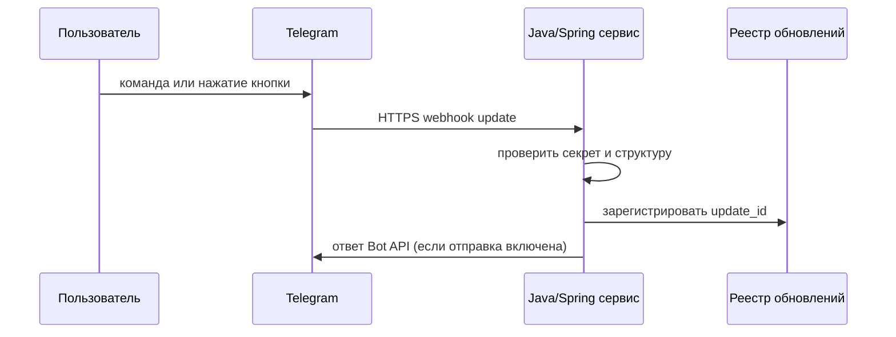

# Шаг 2 — Построить границу bot-сервиса

## Цель обучения

Разобраться в двух направлениях интеграции бота: приложение вызывает Bot API, а Telegram доставляет обновления приложению. Понять, зачем на этой границе нужны защита секрета и идемпотентность.

## Ментальная модель

Исходящий HTTP-вызов — не то же самое, что получение обновлений. Webhook должен быть доступен по HTTPS и проверять настроенный секрет Telegram. Telegram может повторить update, поэтому ключ идемпотентности нужно сохранить до повторения внешнего действия. В примере реестр находится в памяти: он демонстрирует границу, но не подходит для нескольких production-инстансов.

## Прочитать и посмотреть

1. Запустите credential-free [пример Java/Spring](../../examples/java-spring/README.md) и прочитайте раздел конфигурации.
2. Проследите [`TelegramBotClient`](../../examples/java-spring/src/main/java/example/telegram/TelegramBotClient.java) и [`TelegramWebhookController`](../../examples/java-spring/src/main/java/example/telegram/TelegramWebhookController.java).
3. Откройте [`TelegramUpdateRegistry`](../../examples/java-spring/src/main/java/example/telegram/TelegramUpdateRegistry.java) и [тесты webhook](../../examples/java-spring/src/test/java/example/telegram/TelegramWebhookControllerTest.java).
4. Изучите J01–J03: [основа](../../tasks/completed-issues/J01.md), [отправитель](../../tasks/completed-issues/J02.md), [webhook](../../tasks/completed-issues/J03.md).

## Пример применения

В Spring Boot оставьте построение запросов за небольшим клиентом, проверяйте webhook до разбора действий и используйте общую постоянную идемпотентность перед горизонтальным масштабированием. Храните секреты в secret manager. Оставьте отправку выключенной при локальной разработке и тестируйте запросы fake HTTP.

## Самопроверка

Объясните, что произойдёт, если Telegram дважды доставит одинаковый `update_id`, и что изменится при запуске двух реплик. In-memory пример не координирует реплики; production-версии нужно общее хранилище.

**Связанные задачи:** J01–J03. **Проверка:** только локальные mock/unit-тесты; webhook не регистрировался, сообщения не отправлялись.
