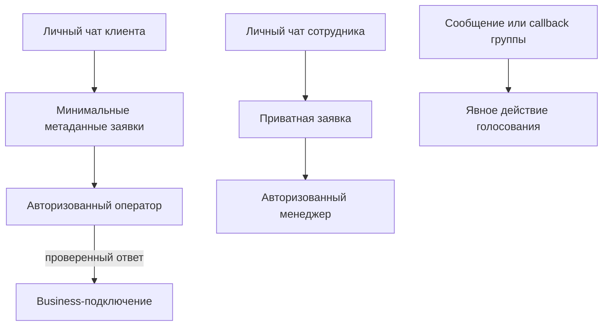

# Шаг 3 — Учесть людей и права в сценариях чата

## Цель обучения

Научиться проектировать Telegram-сценарий вокруг людей и границ доступа, не предполагая, что бот видит все сообщения или может выполнять любые действия.

## Ментальная модель

Личные чаты с ботом, группы, Business-чаты и каналы имеют разные видимость и права. Бот группы получает updates с учётом правил Bot API, privacy mode, членства и прав; это не открывает всю историю. Business-подключение ограничено выбранными чатами и правами. Роли приложения должны поступать из доверенного источника авторизации, а не из имени в Telegram или статуса администратора группы.

## Прочитать и посмотреть

1. Изучите [исследование групп и тем](../02-research/groups-and-topics.md) и [руководство по поддержке](../02-research/support.md).
2. Сравните [`GroupVoteService`](../../examples/java-spring/src/main/java/example/telegram/GroupVoteService.java), [`BusinessSupportService`](../../examples/java-spring/src/main/java/example/telegram/BusinessSupportService.java) и [`InternalRequestService`](../../examples/java-spring/src/main/java/example/telegram/InternalRequestService.java).
3. Прочитайте пояснения [J04](../../tasks/completed-issues/J04.md), [J05](../../tasks/completed-issues/J05.md) и [J15](../../tasks/completed-issues/J15.md).

## Пример применения

Для группового голосования используйте явный callback и проверяйте пользователя, чат, состояние и вариант на сервере. Для клиентской поддержки создайте минимальную заявку и интерфейс авторизованного оператора; разрешайте ответ от имени компании только пока это позволяет Business-подключение. Для согласования сотрудником проверьте его через независимый справочник ролей и требуйте подтверждение важных действий.

## Самопроверка

Для каждой функции бота ответьте: получит ли он update, кто имеет право изменить состояние и что остановит повторное действие по устаревшей или нажатой повторно кнопке?

**Связанные задачи:** J04/J05/J15. В примерах синтетические роли и in-memory состояние; компания, справочник сотрудников и helpdesk не подключались.
