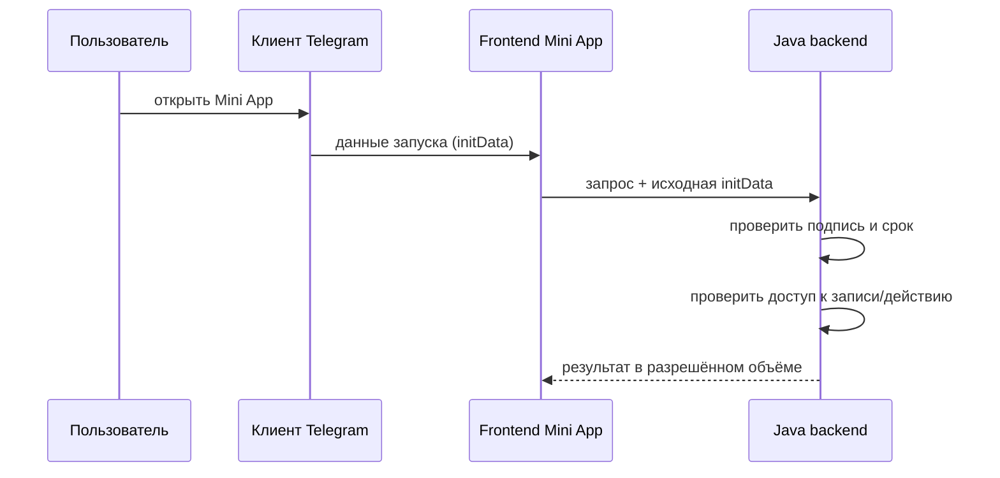

# Шаг 4 — Добавить веб-интерфейс через Mini Apps

## Цель обучения

Понять, когда кнопок и сообщений уже недостаточно, как запуск Mini App связывает Telegram с веб-интерфейсом и почему backend должен проверить identity и права.

## Ментальная модель

Данные запуска Telegram помогают backend установить, какой пользователь открыл приложение, если сервер проверит их подпись. Но это не доказывает, что пользователь владеет любым заказом или может что-то согласовать. Приложение должно самостоятельно проверить доступ к своим записям и действиям. Контекст запуска из группы не создаёт общего доступа и не открывает историю переписки.

### Общее состояние в группе

Mini App, открытая по прямой ссылке Telegram, может получить подписанные поля `chat_type` и `chat_instance`. Они обозначают контекст запуска, но не подтверждают членство пользователя в группе и не разрешают читать любую запись приложения. В J18 показан отдельный server-side allowlist точных пар «чат/пользователь» и хранение пользовательского вклада в общую доску доступности. Другим участникам показываются агрегированные счётчики слотов; самому участнику — только его вклад.

Каждое изменение содержит версию доски, которую пользователь видел при чтении. Сервис атомарно применяет одно изменение и увеличивает версию. Устаревший конфликтующий запрос получает HTTP 409 и последнее состояние, чтобы пользователь мог его проверить и повторить действие. Повтор уже применённого вклада идемпотентен и не увеличивает версию. Этот синхронизированный in-memory пример согласует доступ только внутри одного процесса; нескольким экземплярам нужны общее постоянное хранилище и атомарное обновление БД.

## Прочитать и посмотреть

1. Прочитайте [технические заметки Mini Apps](../02-research/technical-notes.md) и [официальную документацию Mini Apps](https://core.telegram.org/bots/webapps).
2. Изучите [`TelegramInitDataValidator`](../../examples/java-spring/src/main/java/example/telegram/TelegramInitDataValidator.java), [`MiniAppController`](../../examples/java-spring/src/main/java/example/telegram/MiniAppController.java), [`SharedMiniAppController`](../../examples/java-spring/src/main/java/example/telegram/SharedMiniAppController.java), [`SharedAvailabilityBoardService`](../../examples/java-spring/src/main/java/example/telegram/SharedAvailabilityBoardService.java) и их тесты.
3. Прочитайте [J07](../../tasks/completed-issues/J07.md), [J18](../../tasks/completed-issues/J18.md) и инструкции frontend/backend в [README примера](../../examples/java-spring/README.md).

## Пример применения

Оставьте короткие линейные действия сообщениям и кнопкам. Mini App используйте для структурированных форм, пошагового заказа, панели или совместного выбора. Передавайте исходную `initData` backend, проверяйте HMAC и возраст там, а доступ к каждому ресурсу проверяйте отдельно. В совместных сценариях воспринимайте `chat_instance` только как контекст и применяйте собственное правило авторизации. Для реального запуска нужны HTTPS и постоянное хранилище.

## Самопроверка

Почему `initDataUnsafe.user.id` недостаточно для авторизации? Ответ должен включать проверку подписи на сервере и отдельную проверку владельца записи.

**Связанные задачи:** J07 и J18. Тесты используют синтетические подписанные данные; живой запуск Mini App, публичный URL и production-система прав не настраивались.
