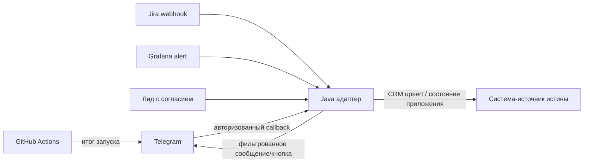

# Шаг 5 — Подключить бизнес-системы и эксплуатацию

## Цель обучения

Рассмотреть Telegram как интерфейс уведомлений и действий вокруг систем-источников истины. Освоить общий шаблон webhook-адаптера и отличать подтверждение в своём приложении от изменения исходной системы.

## Ментальная модель

Храните основное состояние в GitHub, Jira, Grafana или CRM. Telegram пусть показывает полезное событие или принимает узко разрешённое действие. Проверяйте подпись webhook по исходным байтам, фильтруйте и минимизируйте поля, предотвращайте повторы и добавляйте ссылку на источник. Callback, который записывает «увидел» в вашем приложении, автоматически не подтверждает и не закрывает alert в Grafana или задачу Jira. Для важных уведомлений сохраняйте намерение в outbox и делайте поведение при сбоях и дубликатах понятным операторам.

## Прочитать и посмотреть

1. Изучите [технические интеграции](../02-research/technical-integrations.md) и [каталог продуктов](../02-research/product-catalog.md).
2. Проследите [`JiraWebhookController`](../../examples/java-spring/src/main/java/example/telegram/JiraWebhookController.java), [`GrafanaWebhookController`](../../examples/java-spring/src/main/java/example/telegram/GrafanaWebhookController.java), [`SalesLeadService`](../../examples/java-spring/src/main/java/example/telegram/SalesLeadService.java) и [`CiNotificationFormatter`](../../examples/java-spring/src/main/java/example/telegram/CiNotificationFormatter.java).
3. Прочитайте [J06](../../tasks/completed-issues/J06.md), [J08](../../tasks/completed-issues/J08.md), [J09](../../tasks/completed-issues/J09.md) и [J14](../../tasks/completed-issues/J14.md).
4. Прочитайте [J16](../../tasks/completed-issues/J16.md), чтобы сравнить постоянную доставку с best-effort прямой отправкой.

## Пример применения

Начните с одного события и одного адресата: сбой сборки → короткое сообщение и URL workflow. Затем добавьте проверку подписи и фильтры для Jira/Grafana webhook. Для сбора лида попросите клиента явно ввести данные, объясните их использование и отправьте в CRM только эти поля. Разрешения на маркетинговые рассылки учитывайте отдельно. Платформу автоматизации используйте, когда её коннектор действительно поддерживает нужные триггер, действие и контроль доступа: одного названия коннектора недостаточно. Outbox полезен, если потеря уведомления критична; неоднозначный сетевой результат всё равно может привести к дублю.

## Самопроверка

Для кнопки из webhook назовите систему-источник истины, изменяемое состояние, проверку прав пользователя и ключ идемпотентности. Если кнопка меняет только локальное состояние, обозначьте это явно.

**Связанные задачи:** J06/J08/J09/J14/J16. Локальные тесты используют mock; живые GitHub, Jira, Grafana, CRM и Telegram не подключались.
