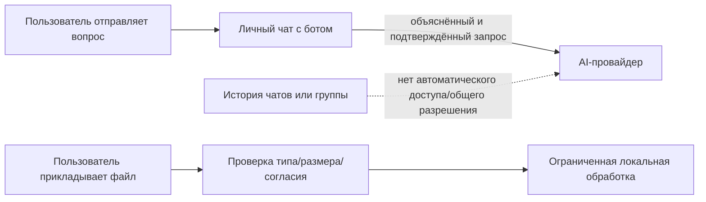

# Шаг 6 — Вдумчиво обрабатывать файлы и AI

## Цель обучения

Разделять вопрос, который пользователь задаёт AI, и индексацию данных из Telegram. Разобраться в границах согласия, обработке файлов, раскрытии провайдера и данных, которые получает бот.

## Два разных потока данных

**AI как интерфейс:** пользователь напрямую пишет боту, знает провайдера и цель и подтверждает конкретный запрос. **Данные Telegram как источник AI:** приложение получает или индексирует сообщения/файлы из чатов. Это разные сценарии. Технический доступ к данным сам по себе не даёт разрешения отправлять их в AI. Условия Telegram ограничивают сбор данных платформы для AI/ML; до такого сценария изучите текущие Telegram API Terms, Content Licensing Terms и Bot Developer Terms. В примере нет загрузки истории или сообщений групп.

## Прочитать и посмотреть

1. Прочитайте [AI и данные Telegram](../02-research/ai-and-data.md) и действующие [Telegram API Terms](https://core.telegram.org/api/terms), [Content Licensing Terms](https://telegram.org/tos/content-licensing), [Bot Developer Terms](https://telegram.org/tos/bot-developers).
2. Изучите [`FileIntakeService`](../../examples/java-spring/src/main/java/example/telegram/FileIntakeService.java), [`BotReplyService`](../../examples/java-spring/src/main/java/example/telegram/BotReplyService.java) и [`ClaudeClient`](../../examples/java-spring/src/main/java/example/telegram/ClaudeClient.java).
3. Прочитайте [J10](../../tasks/completed-issues/J10.md) и [J11](../../tasks/completed-issues/J11.md).

## Пример применения

При приёме файла объясните цель, принимайте только нужные форматы и размеры, временно храните с ограниченным доступом и задайте очистку. Для AI раскройте провайдера и обработку данных, требуйте явное действие на каждый запрос, разрешите отмену и отзыв согласия, чётко обозначьте передачу оператору. Не добавляйте скрытно историю, сообщения групп, файлы клиентов или Business-контент в prompt.

## Самопроверка

Отнесите каждый предполагаемый ввод к категории **передан боту напрямую для этой цели** или **извлечён из Telegram как данные платформы**. Затем назовите выбор пользователя, получателя у провайдера, срок хранения и способ удаления. Вход в аккаунт или общая галочка не дают универсального разрешения на любое использование.

**Связанные задачи:** J10/J11. Тесты используют синтетический текст и mock AI; живых AI-запросов и загрузок файлов из Telegram не было. Правила проверены 2026-11-15; перед запуском перепроверьте.
