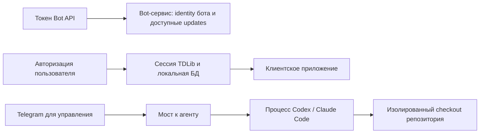

# Шаг 7 — Разобраться в TDLib и мостах к coding-agent

## Цель обучения

Отличать интеграцию бота от приложения, авторизованного как пользователь, и понимать, почему удалённое управление coding-agent требует более строгой изоляции, чем обычный чат-сценарий.

## Ментальная модель

TDLib — клиентская библиотека. Она не превращает бота в клиент пользователя и действует только в рамках доступа авторизованного аккаунта. Файлы сессии и ключи — чувствительные данные аккаунта. Мост к coding-agent добавляет ещё одну границу доверия: кто может давать команды, какие репозитории и shell-инструменты доступны, где работает sandbox и когда нужно подтверждение человека.

## Прочитать и посмотреть

1. Изучите [обзор реализаций](../02-research/implementation-landscape.md): типы продуктов, проверка исходников и факт запуска.
2. Посмотрите изолированный [README TDLib Java](../../examples/tdlib-java/README.md) и [`AuthorizationFlow`](../../examples/tdlib-java/src/main/java/example/telegram/tdlib/AuthorizationFlow.java).
3. Прочитайте [J12](../../tasks/completed-issues/J12.md) и [J13](../../tasks/completed-issues/J13.md).

## Пример применения

Выбирайте TDLib только при продуктовой необходимости клиентского доступа под аккаунтом пользователя; планируйте сборку native-компонентов, защиту сессии, выход и отзыв. Для управления coding-agent с телефона сначала изучите поддерживаемые самим агентом официальные возможности. Собственный мост начинайте с отдельной учётной записи и изолированного checkout, allowlist пользователей и безопасных действий чтения/тестов/подготовки patch; перед записью или shell-командой требуйте подтверждение.

## Самопроверка

Перечислите, какие credentials нужны bot-мосту и TDLib-клиенту, где они выполняются и к чему приведёт кража токена или сессии. Затем назовите ограничение, которое не позволит участнику группы выполнить произвольную команду.

**Связанные задачи:** J12/J13. Fake-тесты авторизации TDLib выполнялись при реализации; JNI-вход и сторонние мосты coding-agent не запускались с реальными аккаунтами или репозиториями.
