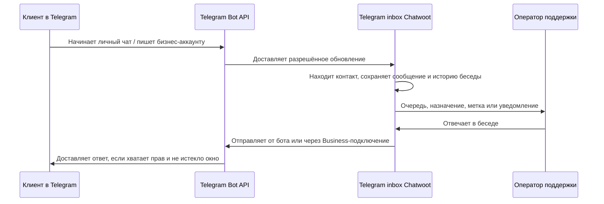

# Шаг 8 — Подключить поддержку Telegram через Chatwoot

## Цель обучения

Отличать встроенный Telegram-канал helpdesk от собственного Java-кода интеграции. Проследить identity клиента, назначение оператору, права на ответ, историю и ограничения mock-теста.

## Два варианта Telegram inbox

**Обычный inbox Bot API:** создайте бота через BotFather, добавьте в Chatwoot Telegram inbox, укажите токен бота и добавьте операторов. Клиент должен сам написать боту; обычный бот отвечает от собственной Telegram identity. Оператор — автор ответа в helpdesk, но Telegram показывает отправителем бота; личный Telegram-аккаунт оператора не участвует. Chatwoot получает обновления, которые Telegram доставляет боту, а операторы отвечают из inbox. Это не превращает бота в Telegram-аккаунт пользователя и не открывает общую историю переписки клиента.

**Telegram Business bot inbox:** Chatwoot документирует поддержку начиная с v4.3.0. Включите Business Mode для бота через BotFather, подключите бота к Telegram Business аккаунту с нужным охватом чатов и правами, затем добавьте его в отдельный Telegram inbox Chatwoot. Обновления Telegram Business содержат ID подключения. Для ответа Telegram требует подключение и право `can_reply`; отвечать можно только в личных чатах, где недавно была входящая активность клиента — в течение 24 часов. Право `can_read_messages` (отметка о прочтении) и права удаления — отдельные: не запрашивайте их без необходимости. Владелец аккаунта выбирает доступные чаты и выдаваемые права. Оператор остаётся автором в helpdesk, а в Telegram сообщение отправляется от имени подключённого бизнес-аккаунта, не личного Telegram-аккаунта оператора.

Окно отсчитывается от последней активности клиента, а не от назначения оператору; передача оператору не останавливает и не продлевает его. По истечении Telegram не примет обычный ответ через Chatwoot. Можно связаться вручную другим разрешённым способом или дождаться нового сообщения клиента. Chatwoot рекомендует выделить Business-боту отдельный inbox: если пользователь раньше общался с тем же ботом напрямую, сообщение иногда выглядит отправленным от бота, а не от бизнес-аккаунта.

Ограничение в 24 часа относится здесь к ответам Telegram Business-бота; не переносите его автоматически на все диалоги Bot API.

## Поток данных

Беседа принадлежит Chatwoot. Исходный код хранит в сообщении текст, отправителя, время, тип, ID канала и беседы, а также метаданные; вложения хранятся отдельными записями/файлами. Chatwoot хранит и данные контакта и беседы; токен бота в Telegram-канале условно шифруется, если настроено шифрование. Для развертывания Chatwoot определите сроки хранения и удаления, доступ, резервные копии и место хранения вложений. «История беседы» — сообщения, которые Chatwoot получил и сохранил; это не архив Telegram-аккаунта и не автоматический импорт старых переписок.

Встроенный канал Chatwoot отвечает за Telegram webhook, сопоставление контактов и бесед, интерфейс операторов, назначение, хранение сообщений и отправку в Telegram. Java-класс [`ChatwootSupportHandoff`](../../examples/java-spring/src/main/java/example/telegram/ChatwootSupportHandoff.java) — **mock-совместимый шов сценария приложения**. Он принимает ссылку на синтетическое входящее сообщение, сохраняет только ID беседы, назначает оператора и разрешает назначенному оператору запросить ответ. В нём нет Telegram-клиента, HTTP-клиента Chatwoot, webhook endpoint, постоянного хранения или credentials. Fake-тест проверяет этот локальный поток и авторизацию, но не реализует канал Chatwoot и не подтверждает живой API-контракт. Для обычного процесса поддержки оператор может работать только в Chatwoot — Java-класс не нужен.

Если позже подключите Java-сервис к Chatwoot, храните API-токены в secret manager или переменных окружения, аутентифицируйте оператора в своём backend и проверяйте подлинность webhook Chatwoot до доверия событию. Не используйте integration token так, чтобы ответ выглядел отправленным другим оператором. Для локальных тестов нужны только синтетические данные; например, `CHATWOOT_BASE_URL`, `CHATWOOT_ACCOUNT_ID`, `CHATWOOT_API_ACCESS_TOKEN` и allowlist ID операторов передаются процессу из окружения. Значения здесь не сохранены.

## J24: офлайн-лаборатория подписанного webhook

В Java-примере появился необязательный шов `POST /chatwoot/webhook` для **исходящего webhook Chatwoot**. Встроенный Telegram inbox Chatwoot по-прежнему владеет Telegram webhook и доставкой сообщений в канал; не настраивайте в этом приложении `getUpdates` или второй Telegram webhook для того же бота. Синтетический сценарий запускается из `examples/java-spring` командой `./gradlew demoChatwootSupport`. Он использует фиксированные тестовые ID и in-memory recorder, не выполняя сетевых запросов.

Endpoint проверяет `X-Chatwoot-Signature` по точным исходным байтам тела с подписанным timestamp и настроенным `CHATWOOT_WEBHOOK_SECRET`, отклоняет timestamp за пределами пяти минут и ограничивает тело до его полной материализации Spring. Принимаются только входящие текстовые события `message_created` от контакта. Тело временно разбирается для маршрутизации ссылки на беседу; текст не передаётся в шов передачи поддержки или fake recorder. Повтор определяется по account ID и message ID из подписанного тела. `X-Chatwoot-Delivery` — необязательные метаданные корреляции; заголовок не входит в подписываемые данные и ключ дедупликации.

Это учебная граница, а не production webhook-сервис: ID событий и состояние передачи ограничены и существуют только в процессе, поэтому перезапуск или несколько экземпляров не обеспечивают долговременную идемпотентность; нет API-клиента Chatwoot, endpoint-аутентификации операторов, постоянной очереди, настройки провайдера или живой проверки совместимости. Реальному развертыванию потребуются общая транзакционная дедупликация, независимая аутентификация действий операторов, политика хранения и сквозная проверка. Целевые тесты: `./gradlew test --tests example.telegram.ChatwootWebhookSignatureValidatorTest --tests example.telegram.ChatwootWebhookControllerTest --tests example.telegram.ChatwootWebhookProcessorTest --tests example.telegram.ChatwootSupportHandoffTest --tests example.telegram.TelegramWebhookBodyLimitFilterTest`. См. [J24](../tasks/completed-issues/J24.md).

## Прочитать и посмотреть

1. Изучите официальные страницы Chatwoot: [настройка Telegram-канала](https://www.chatwoot.com/hc/user-guide/articles/1677838569-how-to-setup-a-telegram-channel) и [обзор каналов и inbox](https://www.chatwoot.com/hc/user-guide/articles/1677492191-adding-inboxes).
2. Прочитайте документацию Telegram: [Business connection и права Bot API](https://core.telegram.org/bots/api#businessconnection) и [руководство по Business-ботам](https://core.telegram.org/bots/features#connected-business-bots).
3. Изучите исходники Chatwoot: [`Channel::Telegram`](https://github.com/chatwoot/chatwoot/blob/develop/app/models/channel/telegram.rb) — регистрация webhook, отправка и `business_connection_id`; [`Message`](https://github.com/chatwoot/chatwoot/blob/develop/app/models/message.rb) — поля хранения и вложения.
4. Сравните [`ChatwootSupportHandoff`](../../examples/java-spring/src/main/java/example/telegram/ChatwootSupportHandoff.java), его [тесты с fake](../../examples/java-spring/src/test/java/example/telegram/ChatwootSupportHandoffTest.java) и [J05](../../tasks/completed-issues/J05.md). J05 — отдельный пример собственного Business Bot API, а не Chatwoot.

## Применение для CVNoor

Chatwoot может послужить ориентиром для **предложенного пилота поддержки CVNoor, требующего одобрения владельца**: Chatwoot управляет работой операторов и историей, а записи кандидатов и работодателей остаются под контролем систем CVNoor. До пилота владелец должен отдельно одобрить канал, аккаунт, состав данных, сроки хранения, круг доступа, правила эскалации и сопоставления личности. В этом репозитории нет реализации или разрешения для CVNoor; H2 outbox из J16 — локальный учебный пример уведомлений, а не доставка сообщений поддержки CVNoor.

## Упражнение и самопроверка

Используйте синтетические `conversation ID 481` и `agent-7`. Запустите целевой тест, затем измените его: попробуйте ответить от другого оператора и проверьте, что fake gateway не получает команду ответа. Нарисуйте такой же поток для Business inbox, отметив право аккаунта `can_reply` и время последнего сообщения клиента.

Перед живым пилотом ответьте: чем идентифицируется контакт, где хранится история, что разрешает sender identity, где проверяется окно ответа и кто может читать или удалять переписку и файлы?

**Граница проверки:** Java-пример тестировался fake gateway и синтетическими ID/текстом. Chatwoot, Telegram-бот, Business-аккаунт и переписка клиента не подключались. Живая проверка нужна для создания канала, доставки webhook, назначения и отображения ответа/sender identity в Telegram, прав Business, вложений, удаления/сроков хранения и поведения конкретной версии.

**Источники проверены:** документация и ветка `develop` Chatwoot, документация Telegram Bot API — 2026-11-15. Перед развертыванием перепроверьте их.
